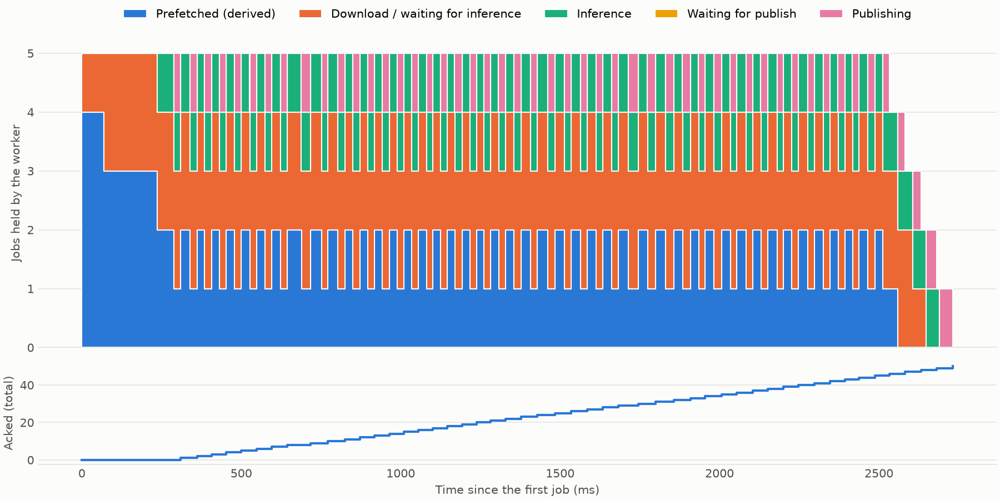

# Job timeline: how many jobs sit in each worker stage

A chart of the Rust worker over time, built from its own log. It answers one question: **which
stage limits the throughput?** For the design of the pipeline itself, see
[worker-pipeline.md](worker-pipeline.md).



## Run it

Stop the worker first, so the queue fills up before it starts:

```
make publish-job COPIES=30    # IMG=data/real/shot_0002.png to change the screenshot
make worker                   # writes out/worker.log, overwritten on each run
make timeline                 # in another terminal, once the queue is empty
```

The chart lands in `out/job_timeline.png`. `make timeline` only reads the log, so it can be re-run
at any time. These are plain `make` targets: PowerShell is enough, no WSL needed.

## Read it

**Top chart: jobs held by the worker.** Each band is the number of jobs in one stage, stacked. The
stack tops out at the prefetch.

| Band | A job is here from | to |
| --- | --- | --- |
| Prefetched (derived) | delivered by RabbitMQ | `job received` |
| Download / waiting for inference | `job received` | `inference started` |
| Inference | `inference started` | `inference finished` |
| Waiting for publish | `inference finished` | `publish started` |
| Publishing | `publish started` | `job acked` |

**Bottom chart: acked total.** The slope is the throughput. It has its own axis because its scale
has nothing to do with the top one.

### What a shape means

| You see | It means | Look at |
| --- | --- | --- |
| Inference always present, a thick band before it | Inference is the bottleneck | Model time |
| Inference with gaps, nothing waiting before it | It is starved | Download, or a higher prefetch |
| A thick Waiting for publish band | The publisher cannot keep up | RustFS upload, broker confirms |
| Stack below 5 while the queue is full | The worker is not filling its prefetch | Consumer loop |
| Flat acked line | Nothing is finishing | Worker log |

## Example

Measured on 2026-11-06 on the dev machine: 50 jobs of 16 cards each, detector `new3` at 512 px,
RustFS and RabbitMQ local. This is the chart above.

| Stage | Mean jobs | Empty |
| --- | --- | --- |
| Prefetched | 1.55 | never |
| Download / waiting for inference | 2.00 | never |
| Inference | 0.99 | 0.8 % of the time |
| Waiting for publish | 0.00 | 99.9 % of the time |
| Publishing | 0.44 | 55.7 % of the time |

- **Throughput: 20 jobs/s, 50 ms per job**, which is the inference time. A job takes about 80 ms end
  to end, so the stages do overlap.
- **Inference is the bottleneck**: it never waits for an image. Speeding up the download or the
  upload would change nothing here.
- **About 3.5 of the 5 prefetch slots are used.** The rest is stock. It would matter on a slower
  network, which this local run cannot show.
- The first 237 ms have no inference, likely the models loading while jobs were already arriving.

## Limits

- **Prefetched is derived, not measured.** Neither RabbitMQ nor `lapin` logs its buffer, so it is the
  free prefetch slots, capped by the jobs still to arrive. It is right when the queue is full before
  the run starts, and overstates otherwise. `Unacked` in the RabbitMQ UI is the measured number.
  `PREFETCH` in `scripts/job_timeline.py` must match `basic_qos` in `consumer.rs`.
- **Download and waiting for inference are one band.** A job blocked on `tx_inference.send` counts
  there. The `image downloaded` line of the log gives the download time alone.
- **Stages are counted from log events, not job ids**: `make publish-job COPIES=n` reuses one id.
- **A run with a failed job still adds up**: it logs `skipping inference` and goes straight to
  Waiting for publish.
- **The numbers are per machine.** They say nothing about prod until measured there.
