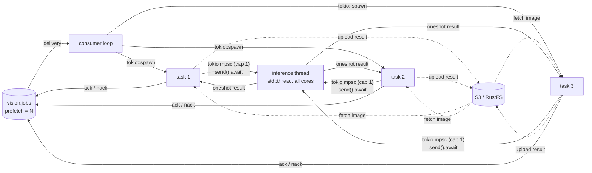
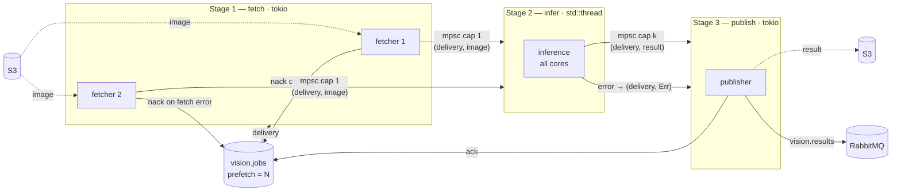
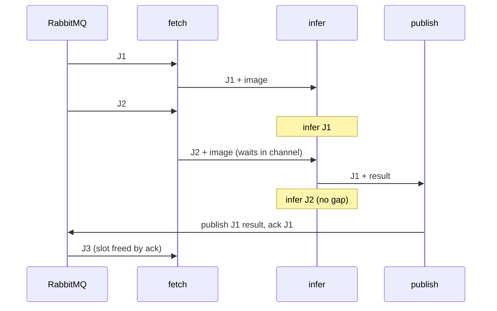

# Worker pipeline: one inference thread, async I/O around it

Inference is CPU-bound and already saturates every core, so it runs on **one** `std::thread`.
Tokio tasks around it fetch the next image and upload the previous result while it computes.
Measured inference: **3.5–4.5 images/s** (~220–285 ms per image). That is the throughput ceiling
per machine; extra workers on the same cores only share it.

## Sequential (current loop): CPU idles during I/O

```mermaid
gantt
    dateFormat X
    axisFormat %L
    section Job 1
    fetch   :a1, 0, 100
    infer   :a2, after a1, 250
    upload  :a3, after a2, 100
    section Job 2
    fetch   :b1, after a3, 100
    infer   :b2, after b1, 250
    upload  :b3, after b2, 100
```



~450 ms per job, of which only 250 ms compute.

## Pipelined (target): I/O overlaps the previous inference

```mermaid
gantt
    dateFormat X
    axisFormat %L
    section Job 1
    fetch   :a1, 0, 100
    infer   :a2, after a1, 250
    upload  :a3, after a2, 100
    section Job 2
    fetch   :b1, 100, 100
    infer   :b2, after a2, 250
    upload  :b3, after b2, 100
    section Job 3
    fetch   :c1, 350, 100
    infer   :c2, after b2, 250
```



Inference runs back to back: one job out every ~250 ms, the slowest stage.

## Components



| Knob | Bounds |
| --- | --- |
| prefetch `N` | jobs in flight in total |
| mpsc capacity | fetched images waiting for the CPU |
| single thread | concurrent inferences (one) |

The inference channel must be `tokio::sync::mpsc` (`send().await` in tasks, `blocking_recv()` in
the thread): a `std::sync::mpsc::SyncSender::send` blocks a runtime thread when the channel is full.

## Stage pipeline: fetch → infer → publish

Same overlap, organised by stage instead of by job: each stage is one long-lived worker, and
bounded channels connect them. The **delivery travels with the job** so the last stage can ack it.





| Stage | How many | Enough as long as |
| --- | --- | --- |
| fetch | 1 sequential task, or one task per delivery | fetch time < infer time (one fetcher suffices) |
| infer | exactly 1 thread | — it is the bottleneck by design |
| publish | 1 task | upload + publish < infer time |

Rules that keep it correct:

- **Ack only after publish.** Acking earlier loses the job if the worker dies before the result is out.
- **Every failure ends in a nack.** A fetch error nacks in stage 1; an infer error rides down to
  stage 3 as `(delivery, Err)` and is nacked there, so one place owns the outcome.
- **The infer → publish channel needs a capacity > 1** (`k` ≈ 2–4): if publish stalls briefly,
  inference keeps going instead of blocking on `blocking_send`. When it is full, inference
  waits — that backpressure is wanted, it stops results piling up in memory.
- **Prefetch bounds the whole thing:** `N ≥ 1 (fetching) + 1 (queued) + 1 (inferring) + k (publishing)`
  covers every slot; a smaller `N` just leaves a stage idle sometimes.

Per-job tasks (above) and per-stage workers give the same throughput. Stages make each step's
concurrency explicit and easy to measure; per-job tasks keep a job's whole lifecycle in one function.

## Sizing the prefetch (Little's law)

```
N = throughput × total latency
  = 4.5 img/s × (fetch 0.1 + infer 0.22 + upload 0.1) s
  ≈ 1.9  → prefetch 2–3
```

That is the floor to keep inference busy; with the stage pipeline, add the publish buffer `k`
on top so a slow publish never starves the fetchers.

Fetch and upload durations are assumptions: measure them against RustFS and redo the sum. S3 stays
hidden as long as each I/O step is shorter than one inference (~220 ms); past that, raise `N`.

## RustFS shares the machine

RustFS runs on the same 2 vCPU as the worker, which changes two things:

- **I/O latency is small** — loopback, no real network — so there is little wait to hide and the
  pipeline gains a few percent, not 2×. `N = 2` is enough; the 100 ms above is a pessimistic
  placeholder.
- **S3 work is CPU work.** Serving and storing objects (HTTP, checksums, disk) burns the cycles
  inference wants. Overlapping it with inference does not make it free: it slows the inference
  it runs beside. The real ceiling is
  `cores ÷ (infer CPU + RustFS CPU per job)`, slightly under the measured 3.5–4.5 img/s.

Measure both: time a fetch/upload against RustFS, and watch RustFS's CPU in `docker stats` under
load. If its share is visible, the lever is a lighter payload (smaller image, compressed result),
not more concurrency.

## Why tokio rather than plain threads

Three jobs in flight need no async runtime: a few `std` threads and channels would do. Tokio stays
because lapin's API is async-only and the S3 client is likely tokio-based too — it is the glue, not
the throughput lever.

## Resources

- Tokio — bridging with sync code: https://tokio.rs/tokio/topics/bridging
- Tokio — channels: https://tokio.rs/tokio/tutorial/channels
- Tokio — spawning: https://tokio.rs/tokio/tutorial/spawning
- Alice Ryhl — *Async: What is blocking?*: https://ryhl.io/blog/async-what-is-blocking/
- Alice Ryhl — *Actors with Tokio*: https://ryhl.io/blog/actors-with-tokio/
- RabbitMQ — consumer prefetch: https://www.rabbitmq.com/docs/consumer-prefetch
- RabbitMQ — consumer acknowledgements: https://www.rabbitmq.com/docs/confirms
- Little's law: https://en.wikipedia.org/wiki/Little%27s_law
